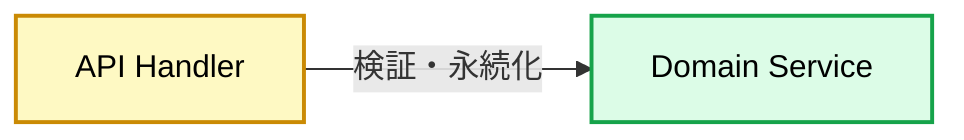

# Human-First PR — Read-Only Chat PR Briefing

すでに出されている Pull Request（またはブランチ差分・パッチファイル）を読み取り専用で解析し、人間が短時間で「なぜ・何を変えた PR か」「どの順番でどこを読めばよいか」を理解できるよう、**Chat 上で自然な言葉＋Mermaid 図解＋読む順番ガイドとして噛み砕いて解説するスキル**です。

---

## 1. 絶対原則（4つの柱）

1. **100% Read-Only（完全読み取り専用）**
   - 対象リポジトリのソースコード編集、AIスロップ削除リファクタリング、`git commit` / `git push` / `git restore` / 作業ツリーを書き換える `git checkout`、`gh pr create` / `gh pr edit`、および `.github/pull_request_template.md` を埋める作業は **一切行わない**。
   - 一時ファイル（トリアージ JSON やセルフリント用下書き）を作る場合は必ず OS の一時領域（`mktemp` 等）を使い、対象リポジトリの `git status --porcelain` を一切汚さない。
   - 解説は原則として **Chat の返答として直接出力**する（ユーザーから明示的にファイル保存を求められた場合のみ指定パスへ保存する）。
2. **目的は「人間がすぐ理解できる Chat PR ブリーフィング」**
   - 作成者になり代わって GitHub 提出用の自己申告文を書くのではなく、**第三者の案内役**として PR の背景・仕組み・設計判断・読む順番・注意点をわかりやすく整理して伝える。
3. **実 Diff 一次根拠主義（既存 PR 説明文は未検証の参考情報）**
   - PR 作成者（または別 AI）が書いた既存の PR タイトル・本文は「未検証の参考情報」として扱う。
   - すべての技術的説明は **実際のコード Diff と実行確認できた事実** を一次根拠とし、PR 説明文の主張（定数値・実装範囲・「全テスト通過済み」等）と実コードに食い違いがあれば明示的に指摘する。
4. **言葉での説明を十分に書く（図の裸置き禁止）**
   - 窮屈な行数切り詰めや機械的なファイル変更実況（「L50 を編集」）を避け、**背景（Why）・変更ストーリー・設計のポイントを自然な日本語（既定は「です・ます」調）でしっかり言葉にする**。
   - Mermaid 図だけを裸で置かず、図の前後に「何を表す図か」「どの経路・状態変化が今回の核心か」を必ず言葉で補足する（`BR010`）。

---

## 2. 起動条件と隣接スキルとの境界

| ユーザーの依頼内容 | 本スキルの対象か | 適切な対応・委譲先 |
|---|---|---|
| 既存 PR（番号・URL・ローカル差分・`.patch`）の全体像・仕組み・読む順番を Chat で解説してほしい | **対象（起動する）** | 本スキルの 3-Step Pipeline を実行 |
| AI が書いた大きな PR のノイズや冗長コードに惑わされず、本質箇所だけ教えてほしい | **対象（起動する）** | コードは編集せず、解説側でボイラープレートを濾過して案内 |
| このブランチで PR を新規作成して / `gh pr create` して | **対象外** | 通常の PR 作成フロー（本スキルは起動しない） |
| 既存 PR #123 の説明文を `gh pr edit` で書き換えて更新して | **対象外** | GitHub PR 編集作業（本スキルは Read-Only 解説専用） |
| PR を出す前に冗長な try-catch や不要コメントを削ってコードを掃除して | **対象外** | `deslop` スキル |
| PR にバグ・競合状態・セキュリティ脆弱性がないか厳しく監査して指摘して | **対象外** | `fable-code-review` / `yharuto-code-review` スキル |
| ステージ済み差分からコミットメッセージを作って | **対象外** | `commit-message` スキル |
| PR と無関係なドキュメントや案内文の日本語を推敲して | **対象外** | `yomiyasu` スキル |

---

## 3. 3-Step PR Comprehension Pipeline（取得 → 仕分け → Chat図解解説）

解説は以下の 3 ステップを一気通貫で実行し、最後に必ず `pr_briefing_lint.py` の自己検査を通過させてから Chat に出力します。`<skill-dir>` は本 `SKILL.md` が置かれているディレクトリを指します。

### リファレンス文書の段階的読み込み（Progressive Disclosure）

コンテキスト消費を抑えるため、必要な場面でのみ該当リファレンスを読み込みます。

| リファレンス | 読み込むタイミング | 注意事項 |
|---|---|---|
| [references/triage-rules.md](references/triage-rules.md) | Step 1〜2 で強制昇格警告・`boilerplate_heavy` 行レンジ濾過・特殊 PR・Size XL 分割読解を扱うとき | 3階層辞書と規模判定の詳細正本 |
| [references/mermaid-and-templates.md](references/mermaid-and-templates.md) | Step 3 で **Size M / L / XL** の図解・構成・Text-Only モードを作成するとき | **Size S では読み込み禁止**（過剰装飾防止） |
| [references/japanese-pr-style.md](references/japanese-pr-style.md) | Step 3 で文章スタイル・AIクリシェ回避（`BR005`）・PR説明文とのギャップ表現を確認するとき | `/yomiyasu` 連携と日本語表現の正本 |

---

### Step 1: PR Context & Diff Acquisition（PR情報・差分の取得）

入力ソースに応じて以下の 3 経路から読み取り専用で情報を取得し、一時ファイル `$TMP_TRIAGE`（例: `mktemp /tmp/hfpr_triage.XXXXXX.json`）へ保存します。

1. **経路①：GitHub PR 番号・URL 指定**（ローカル checkout 不要）
   ```bash
   gh pr view <num|url> --json number,title,body,baseRefName,headRefName,url
   python3 <skill-dir>/scripts/pr_diff_triage.py --pr <num|url> --pretty > "$TMP_TRIAGE"
   ```
   - `gh pr diff <num|url>`（または特定ファイルの差分確認）で実コードの変更内容を読み取る。既存 PR の `body` は未検証情報として保持し、後のギャップ照合に使う。
2. **経路②：ローカル Git リポジトリのブランチ / 作業差分**
   ```bash
   python3 <skill-dir>/scripts/pr_diff_triage.py --repo <repo_path> [--base <ref>] [--head <ref>] --mode {committed,working,all} --pretty > "$TMP_TRIAGE"
   ```
   - 既定は `--mode committed`（ベースとのコミット済み差分）。未コミット変更を含めて解説を求められた場合のみ `working` または `all` を選ぶ。
3. **経路③：Unified Diff パッチファイル / 標準入力**（Git リポジトリ外でも実行可）
   ```bash
   python3 <skill-dir>/scripts/pr_diff_triage.py --patch-file <path|-> --pretty > "$TMP_TRIAGE"
   ```

**Step 1 の確認事項**:
- リポジトリ内の `CLAUDE.md` / `AGENTS.md` やユーザー指示に「絵文字禁止」がある場合は **Text-Only モード**（`--badge-mode text`: `[SCOPE]`, `[TARGET]`, `[MUST]`, `[SKIM]`, `[SKIP]`）を選択する。
- テスト通過状況は、CI 結果（`gh pr checks`）やローカル環境で安全に読み取り実行できた結果のみを事実として扱い、環境変数不足（DB DSN 未設定等）やパッチ単体入力で未実行の場合は正直に「未確認（環境変数未設定のためローカル実行不可 等）」と記載する。推測で「全テスト通過済み」と断定してはならない（`BR006`）。

---

### Step 2: Signal / Noise Triage & Boilerplate Filtering（ノイズ隔離と読むべき箇所の仕分け）

`$TMP_TRIAGE` の出力（`summary`, `warnings`, `dependencies`, `files`, `ai_override_guidance`）と実 Diff を照合し、解説方針を確定します（詳細規則は [references/triage-rules.md](references/triage-rules.md) 参照）。

1. **3 階層の仕分けと強制昇格の確認**
   - `🧠 Must-Read`（`[MUST]`）: コアロジック、API 境界、認証・認可・決済・CI ワークフロー・DB マイグレーション等のリスクパス。
   - `👀 Skim`（`[SKIM]`）: テストコード、ドキュメント、`import_path_only`（import 文のみの変更）、定型設定。
   - `⏭️ Safe-to-Skip`（`[SKIP]`）: lockfile、自動生成コード、Drizzle/Prisma メタデータ、ビルド成果物、スナップショット、純粋な依存追加のみのマニフェスト。
   - **警告フラグの精査**:
     - `SUSPECTED_MANUAL_GEN_EDIT`: `DO NOT EDIT` 等の生成ファイルにスキーマ変更を伴わない手動編集や `TODO`/`HACK` がある場合、`Must-Read` に昇格させ「再生成で消える手動パッチの疑い」を必ず解説で警告する。
     - `NON_DEPENDENCY_MANIFEST_CHANGE` / `LOCKFILE_WITHOUT_MANIFEST` / `TEST_SKIP_OR_ASSERTION_REMOVAL` が検出された場合も理由を確認し注意ポイントに載せる。
2. **Read-Only ボイラープレート濾過（`boilerplate_heavy` 対応）**
   - AI が生成した PR には、防衛的な多重 `None` チェック、薄いパススルーラッパー関数、自明な What コメント、冗長な `try/except` が混在しやすい。
   - コードを書き換えて削る代わりに、**実 Diff を読んで本質ロジックと定型ボイラープレートを解説側で切り分ける**。
   - `flags` に `"boilerplate_heavy"` があるファイルや冗長構造が目立つファイルでは、「`L220〜L250` の `create_order_summary` が金額計算と検証の本質ロジックであり、前半の補助ラッパー関数群は定型チェックのみのため流し読みでよい」のように具体的な行レンジ・関数名で読解負荷を下げる。
3. **解説規模（Size S / M / L / XL）と特殊ケースの確定**
   - **Size S**: `effective_files <= 2` かつ `effective_lines < 30` かつ本番コード変更が単一機能レイヤー以下（リスクパスや手動生成改変なし）。
   - **Size M**: 標準的な機能追加・バグ修正（`effective_files <= 10`, `effective_lines <= 300`）。
   - **Size L**: 複数レイヤー・DB スキーマ・非同期ワーカー等をまたぐ中〜大規模変更（`effective_files <= 20`, `effective_lines <= 600`）。
   - **Size XL**: 巨大 PR（`effective_lines > 600`、`effective_files > 20`、推定読解 `> 45分`、または `>= 4層` かつ `> 400行`）。すでに出されている PR であるため、作成者への PR 分割要求ではなく **読み手が段階的に理解するための「分割読解ガイド（Reading Chunks）」** を用意する。
   - **`summary.special_case` 別の扱い**:
     - `empty_diff`: 差分が 0 件である旨と指定ブランチ／ベース参照の確認ポイントを簡潔に伝える。
     - `skip_only`: lockfile や自動生成物のみの変更であることを伝え、マニフェストとの整合性（`LOCKFILE_WITHOUT_MANIFEST` の有無）と再生成コマンドの妥当性だけを案内する。
     - `docs_or_config_only`: ドキュメント・CI 設定のみの変更を過剰に Size XL 扱いしない。ただし `.github/workflows/` 等の CI 変更は `Safe-to-Skip` に入れず読解対象として解説する。
     - `deletion_heavy`: 不要機能・旧コード撤去が主体の PR。Scope バナーの客観的な `-N行` 表記は残しつつ、「スロップを N 行削減した」のような自慢表現は書かない（`BR006`）。

---

### Step 3: Visual & Verbal PR Briefing on Chat（Chat上での言葉＋図解によるPR解説）

確定したサイズに応じて Chat 解説を組み立てます（文体と表現ルールは [references/japanese-pr-style.md](references/japanese-pr-style.md) 参照）。

#### A. Size S の出力構成（小変更：本セクションが正本テンプレート）

- **厳守事項**: Mermaid 図、`> 🎯 Scope:` バナー、Markdown 表、`<details>` 折りたたみは **一切出力しない**（`BR003_SIZE_S_OVERKILL`）。[references/mermaid-and-templates.md](references/mermaid-and-templates.md) も読み込まない。
- 以下の構成で、言葉と箇条書きのみで明快に解説する：

```markdown
## 全体像
<何の課題・バグに対するPRか（背景 Why）と、どこをどう変えて挙動がどう変わるようになったかを、自然な文章で3〜6行程度でわかりやすく説明する>

## 主な変更と確認ポイント
- `<ファイルパス>`（`<関数・クラス名>`）: <変更内容と入力・出力の振る舞い変化（機械的な行番号実況ではなく意味単位で説明）>
- 依存パッケージ（追加・更新がある場合のみ）: `<パッケージ名>`（<導入理由を1文で説明>）
- 確認ポイント: <追加テストの内容、実行確認できた結果または未確認事項、既存PR説明文との差異があれば明記>
```

#### B. Size M / L / XL の出力構成（中〜大規模変更）

作成前に [references/mermaid-and-templates.md](references/mermaid-and-templates.md) を読み込み、以下の 5 セクション構成で出力します（Text-Only モード時は絵文字を `[SCOPE]` / `[TARGET]` / `[MUST]` / `[SKIM]` / `[SKIP]` に統一し、一切混在させない）。

1. **`## 全体像（なぜ・何を変えたPRか）`**（または `## 全体像`）
   - **3〜10行目安（上限12行、`BR002`）** の自然な日本語で、従来の課題（Why）・今回の解決アプローチ・変更後の処理ストーリーを言葉で丁寧に説明する（必要に応じて要点箇条書きを併用可）。
   - セクション末尾に **Scope バナー** を置く（`BR004`）：
     `> 🎯 Scope: 総差分 <total_files>ファイル (+<added>/-<deleted>行) → 実質読むべき箇所 <effective_files>ファイル (<effective_lines>行) | 推定読解: 約<min>〜<max>分 | Size <M|L|XL>`
2. **`## 仕組み・処理フロー`**
   - 変更の性質に最も合う Mermaid 図を **1〜2 図（上限 3 図、`BR007`）** 作成する：
     - コンポーネント関係・責務境界の変更 → `flowchart LR`（または `TD`）
     - API・DB・非同期ワーカーの時系列連携 → `sequenceDiagram`
     - ステータス・リトライ・ライフサイクル遷移 → `stateDiagram-v2`
     - テーブル新設・外部キー構造の変更 → `erDiagram`
   - **図の前後の言語補足（必須、`BR010`）**: 図の前に「この図が示す全体構造」、図の後に「今回の PR で新設・変更された経路と注目すべきデータの流れ」を **2〜4行以上の散文または箇条書き** で必ず説明する。
   - **Mermaid GFM 安全規約（`BR007`〜`BR009`）**:
     - 1 図あたりユニークノード／アクター数は **8 個以下目安（絶対上限 10 個）**。
     - 括弧・スラッシュ・コロン・日本語等を含むラベルは必ず `"..."` で囲む。生 `<>` 禁止（改行は `<br/>`）、`:::` 短縮記法禁止、予約語裸 ID（`end`, `default`, `class`, `style` 等）禁止。
     - `classDef` は **`flowchart` のみ** で使用し、必ず `color:#000` を含む規定 4 色（`added`: `fill:#dcfce7,stroke:#16a34a,stroke-width:2px,color:#000` / `modified`: `fill:#fef9c3,stroke:#ca8a04,stroke-width:2px,color:#000` / `risk`: `fill:#fee2e2,stroke:#dc2626,stroke-width:2px,color:#000` / `base`: `fill:#f3f4f6,stroke:#6b7280,stroke-width:1px,color:#000`）を使う。
3. **`## 主な変更ポイントと設計判断`**
   - 変更を意味のあるまとまりごとに言葉で解説する。`- **変更点**: 〜` や `- **改善点**: 〜` のような分類ラベル太字箇条書きは禁止（`BR015`）。
   - `dependencies` に追加・更新パッケージがある場合は、**すべてのパッケージ名と導入理由を 1 行で明記**する（`BR013`）。
   - 複数の設計案・トレードオフがある変更（特に Size L / XL）では、`◎ / ○ / △ / ×` を用いた **設計判断の比較表** を添えて「なぜこの方式を採っているか」を明確にする。
4. **`## 読む順番ガイド`**
   - `### 🎯 読むべきファイル`（Text-Only 時は `### [TARGET] 読むべきファイル`）を置き、`must_read` 全件を漏れなく含めて **人間の理解が最もスムーズに進む順序**（例：DBスキーマ・型／値オブジェクト → ドメイン／コアロジック → ワーカー／APIハンドラ → ルーティング → `👀 Skim` のテスト・ドキュメントは後半）で番号付き表にする（単純アルファベット順の羅列は避ける、`BR012`）。
   - 表の「変更・注目ポイント」列には、核心の関数名・行レンジに加え、冗長な防衛コードやラッパーがある場合の **ボイラープレート読み飛ばし案内** を具体的に書く。
   - ノイズ比率が高い場合（`noise_ratio_pct >= 30%` かつ `safe_to_skip_lines >= 50` かつ非ゼロ区分 2 つ以上）は `pie showData` で実質コードとノイズ行数の内訳を図示する（値 `0` のスライスは入れない）。
   - `safe_to_skip_files > 0` の場合は、必ず `<details><summary>⏭️ Safe-to-Skip（自動生成・ロックファイル等 N件 / +A -D行）</summary>...</details>`（Text-Only 時は `[SKIP]`）で折りたたむ（`BR011`）。
5. **`## 注意・確認ポイント`**
   - 生成ファイルの手動改変疑い（`SUSPECTED_MANUAL_GEN_EDIT`）、テスト `.skip`・アサーション削除、DB マイグレーションやレスポンス形式変更などの破壊的変更リスク、未実行テストの条件を整理する。
   - **PR 作成者説明文とのギャップ**: 既存 PR 本文に実 Diff と食い違う記述（誤った定数値、未実装機能の記載、根拠のないテスト全パス宣言等）がある場合は、実コードの該当箇所を示して穏やかかつ明確に指摘する。
   - **Size XL 時の分割読解ガイド（Reading Chunks）**: 巨大な PR を 2〜4 個のテーマ別チャンク（例：Chunk 1 データ層 → Chunk 2 非同期処理層 → Chunk 3 API・テスト層）に分け、チャンクごとの所要時間目安と確認観点を案内する。

#### C. Size M / L / XL の標準骨格（出力イメージ）

````markdown
## 全体像（なぜ・何を変えたPRか）
<背景課題 Why・解決アプローチ・変更後の流れを自然な言葉で3〜10行で解説>

> 🎯 Scope: 総差分 <total_files>ファイル (+<add>/-<del>行) → 実質読むべき箇所 <effective_files>ファイル (<effective_lines>行) | 推定読解: 約<min>〜<max>分 | Size <M|L|XL>

## 仕組み・処理フロー
<図の前に2〜4行で、この図が示す構造やリクエストの流れを言葉で導入する>



<図の後に2〜4行で、新設・変更された境界やデータの受け渡しポイントを補足する>

## 主な変更ポイントと設計判断
- <意味単位の変更ポイント解説（分類ラベル太字は使わない）>
- 依存追加（該当する場合）: `<pkg>`（<導入理由を1文で説明>）
<代替案とのトレードオフがある場合のみ ◎/○/△/× 比較表を配置>

## 読む順番ガイド
### 🎯 読むべきファイル
| 優先順 | ファイル | 区分 | 変更・注目ポイント |
|---|---|---|---|
| 1 | `path/to/core.py` | 🧠 Must-Read | `func_name`（L40〜L75）が核心。前半の定型ラッパーは流し読み可 |
| 2 | `tests/test_core.py` | 👀 Skim | 正常系・境界値の期待挙動を確認 |

<details>
<summary>⏭️ Safe-to-Skip（自動生成・ロックファイル等 N件 / +A -D行）</summary>

- `uv.lock` (+2998/-3): `pyproject.toml` の依存更新に伴うロックファイル差分

</details>

## 注意・確認ポイント
- <生成ファイル手動改変警告・DB移行確認・テスト未確認条件・既存PR説明文との食い違い等>
````

---

## 4. 出力前セルフリント（`pr_briefing_lint.py` 必須実行）

Chat へ最終回答を出す前に、解説ドラフトを一時ファイル `$TMP_BRIEFING` に書き出し、必ず以下のセルフリントを実行します。

```bash
python3 <skill-dir>/scripts/pr_briefing_lint.py "$TMP_BRIEFING" \
  --size <S|M|L|XL> \
  --triage-json "$TMP_TRIAGE" \
  [--badge-mode {auto,emoji,text}] \
  --yomiyasu-lint \
  --json
```

### 検査ルール一覧（`BR001`〜`BR016`）

| Rule ID | 対象 | 重大度 | 検査内容 |
|---|---|---|---|
| `BR001_OVERVIEW_MISSING` | ALL | FAIL | 冒頭の全体像セクション（`## 全体像` 等）と導入説明文が存在するか |
| `BR002_OVERVIEW_LENGTH` | ALL | WARN/FAIL | 全体像が短すぎないか（`<30字` WARN）、逆に長すぎないか（`>18行` 等 FAIL） |
| `BR003_SIZE_S_OVERKILL` | S | FAIL | Size S で Mermaid 図・Scope バナー・表・`<details>` を出していないか |
| `BR004_MISSING_SCOPE_SUMMARY` | M/L/XL | FAIL | `> 🎯 Scope:` または `> [SCOPE]` の見かけ行数 vs 実質行数サマリーがあるか |
| `BR005_AI_CLICHE_DETECTED` | ALL | FAIL | 「堅牢性を向上」「包括的な」「シームレスに統合」等の日英 AI クリシェがないか |
| `BR006_PR_AUTHOR_MODE_CONFUSION` | ALL | FAIL | PR テンプレ HTML コメント残存・未検証テスト完了断言・コード削減量自慢がないか |
| `BR007_MERMAID_NODE_LIMIT` | M/L/XL | WARN/FAIL | Mermaid 総数 `<=3`、各図ユニークノード／アクター数 `<=10`（`9〜10` WARN）か |
| `BR008_MERMAID_UNQUOTED_SPECIAL` | M/L/XL | FAIL | ラベル `"` クォート漏れ・予約語裸 ID・`:::`・生 `<>` 等の GFM 構文違反がないか |
| `BR009_MERMAID_CLASSDEF_COLOR` | M/L/XL | WARN/FAIL | `flowchart` 限定の `classDef`・`color:#000` 必須・規定 4 色パレット準拠か |
| `BR010_MERMAID_WITHOUT_PROSE` | M/L/XL | WARN | Mermaid 図を含むセクション内に、図を言葉で補足する文章・箇条書きがあるか |
| `BR011_DETAILS_MISSING_FOR_SKIP` | M/L/XL | FAIL | `safe_to_skip_files > 0` のときに `<details>` / `<summary>` 折りたたみがあるか |
| `BR012_READING_GUIDE_COVERAGE` | M/L/XL | WARN/FAIL | `must_read` 全パスが読む順番ガイドに含まれ、単純辞書順の羅列になっていないか |
| `BR013_DEPENDENCY_EXPLANATION` | ALL | FAIL | `dependencies` の追加・更新パッケージ名が解説本文で説明されているか |
| `BR014_EMOJI_HYGIENE` | ALL | WARN/FAIL | 許可 4 種（`🎯🧠👀⏭️`）以外の装飾絵文字がないか、絵文字／テキスト混在がないか |
| `BR015_CLASSIFICATION_BOLD_LABEL` | ALL | FAIL | `- **変更点**: 〜` 等の分類ラベル太字箇条書きが使われていないか |
| `BR016_AUXILIARY_KANJI` | ALL | WARN | 「する事」「する為」等の補助動詞・形式名詞漢字が残っていないか |

- `FAIL` が 1 件でも出た場合はドラフトを修正して再実行し、**終了コード `0`**（かつ `WARN` も原則解消）を確認してから一時ファイルを削除し、完成した解説を Chat に出力する。
