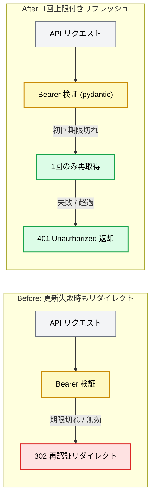
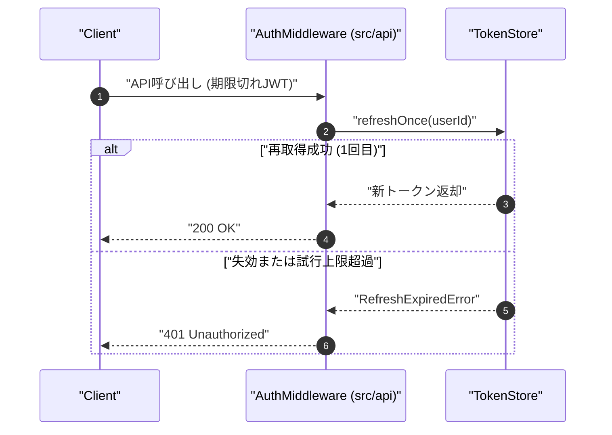
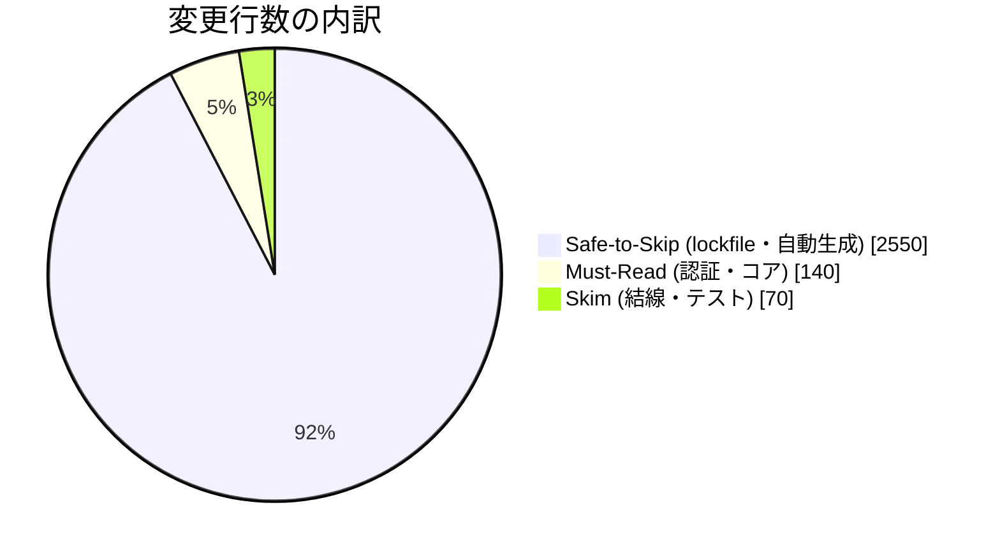
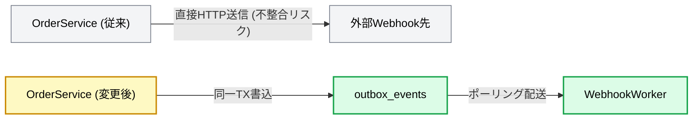
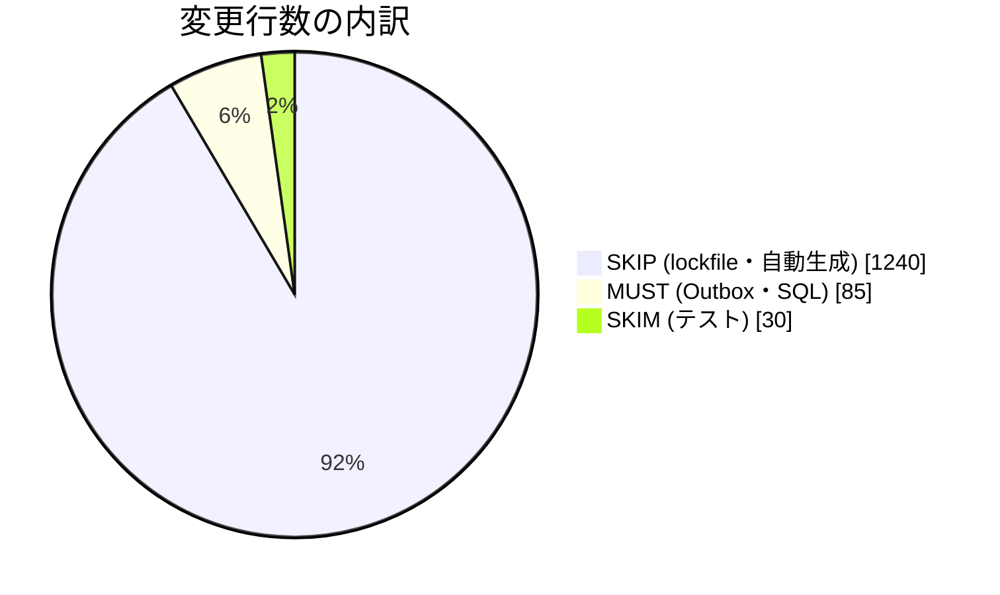

# Step 3: Chat PR 解説テンプレート & GFM Mermaid 安全規約

本ドキュメントは、`3-Step PR Comprehension Pipeline（取得 → 仕分け → Chat図解解説）` の Step 3 でエージェントが Chat 上に出力する Size M / L / XL 向け解説テンプレート、Text-Only モード仕様、Mermaid 図種選定、および GitHub Flavored Markdown（GFM）/ Chat レンダラ共通の安全規約を定める正本である。

## 目次

- [1. Chat 解説テンプレート骨格（Size M / L / XL 用）](#1-chat-解説テンプレート骨格size-m--l--xl-用)
- [2. Text-Only モード仕様（`--badge-mode text`）](#2-text-only-モード仕様--badge-mode-text)
- [3. Mermaid 5 種ルーティング表と図数上限](#3-mermaid-5-種ルーティング表と図数上限)
- [4. GFM / Chat Mermaid 完全安全規約](#4-gfm--chat-mermaid-完全安全規約)
- [5. 検証済み Chat 解説サンプル 3 例](#5-検証済み-chat-解説サンプル-3-例)

---

## 1. Chat 解説テンプレート骨格（Size M / L / XL 用）

> [!NOTE]
> **Size S の簡潔解説テンプレート本体は `SKILL.md` を正本とし、本書では重複定義しない。** Size S 判定時は Mermaid 図・Scope バナー・Markdown 表・`<details>` 折りたたみを一切出力せず（`BR003`）、背景・変更内容・確認ポイントを自然な言葉と箇条書きのみで解説する（規模判定閾値は [triage-rules.md](triage-rules.md)、日本語スタイル規約は [japanese-pr-style.md](japanese-pr-style.md) を参照）。

### 1.1 標準 5 セクション構成（Size M / Size L）

すでに出されている PR を人間が上から読むだけで全体像から細部まで段階的に把握できるよう、以下の 5 セクション構成で出力する。文体はユーザーへの Chat 解説として自然な **敬体（「です・ます」調）を既定** とする。

1. **`## 全体像（なぜ・何を変えたPRか）`（必須: `BR001`, `BR002`, `BR004`）**:
   - **言葉による導入解説（3〜10 行目安、要点箇条書き 2〜4 点の併用可）**: 「従来どのような課題・背景があったか（Why）」「意味単位で何を変えたか」「外部から観測できる振る舞いがどう変わるか」を噛み砕いて説明する（空白・記号を除き 30 字未満は説明不足として `BR002` WARN、非空行 18 行超または日本語 1,000 字超は長大化として `BR002` FAIL）。
   - **`> 🎯 Scope:` バナー（直下に必須: `BR004`）**: 見かけの総変更行数・ファイル数と、ノイズを除いた実質読むべき行数・ファイル数・推定読解時間を 1 行の引用ブロックで対比表示する。
2. **`## 仕組み・処理フロー`（必須: `BR007`〜`BR010`）**:
   - 構造変化や時系列・状態遷移を表す Mermaid 図（`flowchart LR` / `sequenceDiagram` / `stateDiagram-v2` / `erDiagram`）を **1〜2 図** 配置する。
   - **図の前後に必ず 2〜4 行以上の言語解説を添える（`BR010`）**: 図だけを裸で置くことは禁止する。図の前に「従来の構造のどこに課題があり、どう変えたか」、図の後に「正常系と異常系の分岐条件や注目すべき経路」を言葉で補足する。
3. **`## 主な変更ポイントと設計判断`（必須: `BR013`）**:
   - ファイルごとの逐語実況ではなく、**責務・意味のまとまり単位**で「どこをどう変えて、なぜその設計にしているか」を文章と箇条書きで解説する。
   - 依存パッケージの追加・更新（`dependencies.added` / `updated`）がある場合は、パッケージ名と導入・更新理由を 1 行で必ず明記する（例: `- 依存追加: pydantic（リクエスト境界の型検証とフィールド単位のエラー返却を行うため）`）。
   - 複数の実装案やトレードオフの比較が有効な場合のみ、`◎ / ○ / △ / ×` を使った設計比較表を添える（比較対象がない素直な変更では表を省略し、言葉の説明のみとする）。
4. **`## 読む順番ガイド`（必須: `BR011`, `BR012`）**:
   - 定量条件（`noise_ratio_pct >= 30%` かつ `safe_to_skip_lines >= 50` かつ非ゼロ区分 2 つ以上）を満たす場合のみ、冒頭に `pie showData` で変更行数の内訳図を添え、1〜2 行の補足文を置く。
   - **`### 🎯 読むべきファイル`**: `must_read` 全ファイルを漏れなく含め、**人間が理解しやすい順番（① 型・DB スキーマ契約 → ② ドメイン・コアロジック → ③ API・UI 結線 → ④ テスト）** で番号付き表を作成する（機械的なアルファベット順は避ける）。
   - 各行の「注目箇所・読み方メモ」欄には、**具体的な行レンジ**と **`boilerplate_heavy` 箇所の読み飛ばし案内**（例: `L18〜L52 の期限判定が本質です。後半の定型ラッパーは流し読みで問題ありません`）を明記する。
   - `safe_to_skip_files > 0` の場合は `<details>` と `<summary>⏭️ Safe-to-Skip（Nファイル / M行）</summary>` でロックファイルや自動生成物を折りたたむ。
5. **`## 注意・確認ポイント`（該当事項がある場合に配置）**:
   - 以下の確認観点がある場合に配置する（特記事項がない単純な変更では省略可）：
     - 自動生成ファイルの手動改変疑い（`SUSPECTED_MANUAL_GEN_EDIT`）
     - テストの `.skip` 追加やアサーション削除（`TEST_SKIP_OR_ASSERTION_REMOVAL`）
     - DB マイグレーションのロック影響・後方互換性・環境変数追加
     - **PR 作成者の説明文と実 Diff のギャップ**（説明文にあるが未実装の項目、テスト未確認事項の切り分け）
     - エージェントが手元で実行確認したコマンド結果と、未確認事項の区別
     - **Size XL 時の分割読解順（Reading Chunks）**

### 1.2 Size XL 判定時の「分割読解ガイド（Reading Chunks）」構成

すでに出されている PR が Size XL の場合は、PR を作り直させる分割提案ではなく、**巨大な既存 PR をテーマ別・段階別に区切って読み解くガイド（Reading Chunks）** を `## 読む順番ガイド` または `## 注意・確認ポイント` 内に編成する。

```markdown
### 分割読解ガイド（Reading Chunks）

変更規模が大きいため（24ファイル / 実質 740行）、一度にすべてを追わず以下の3チャンクに分けて読み進めるのがおすすめです。

1. Chunk 1: データ契約とマイグレーション（目安 10分）
   - `db/migrations/008_invoice.sql`（L1〜L45 のテーブル定義と一意制約）、`src/types/invoice.ts`
   - 請求ステータスの状態値と外部キー制約の整合を先に押さえます。
2. Chunk 2: 請求計算と状態遷移のコアロジック（目安 15分）
   - `src/domain/invoice_calculator.ts`（L20〜L95 の端数処理と税率計算のみ熟読、後半の DTO 変換は流し読み可）
   - 割引適用順序とキャンセル時の再計算条件を確認します。
3. Chunk 3: API エンドポイント結線と異常系テスト（目安 10分）
   - `src/api/invoice_routes.ts`、`tests/test_invoice_calculator.ts`
   - 認可チェックの適用漏れがないかと境界値テストの網羅範囲を確認します。
```

---

## 2. Text-Only モード仕様（`--badge-mode text`）

ユーザーが「絵文字なし」「テキスト表記で」と指定した場合、またはリポジトリの `CLAUDE.md` / `AGENTS.md` / `.yomiyasu-words/` に絵文字禁止指定がある場合は、`--badge-mode text` を適用し、4 種の構造バッジを含め**絵文字を 1 文字も出力しない**。同一解説内での絵文字バッジとテキストバッジの混在も禁止する（`BR014` FAIL）。

| 出力位置 | Visual Badge Mode（既定: `auto` / `emoji`） | Text-Only Mode（`--badge-mode text`） |
|---|---|---|
| Scope バナー行頭 | `> 🎯 Scope: ...` | `> [SCOPE] ...` |
| 読むべきファイル見出し | `### 🎯 読むべきファイル` | `### [TARGET] 読むべきファイル`（または `### 読むべきファイル`） |
| 熟読対象区分 | `🧠 Must-Read` | `[MUST]` |
| 流し読み対象区分 | `👀 Skim` | `[SKIM]` |
| 読み飛ばし可区分 | `⏭️ Safe-to-Skip` | `[SKIP]` |
| `<summary>` 行頭 | `<summary>⏭️ Safe-to-Skip（Nファイル / M行）</summary>` | `<summary>[SKIP] Safe-to-Skip（Nファイル / M行）</summary>` |
| `pie showData` ラベル | `"Must-Read (認証・コア)" : 140`（図内も絵文字なし） | `"MUST (認証・コア)" : 140` |

- Text-Only Mode で区分の凡例を添える場合は、表の直前に `区分: [MUST] 熟読 / [SKIM] 流し読み / [SKIP] 自動生成・ロックファイル` と 1 行で記載する。行頭が `[MUST]: ...` となると Markdown の参照リンク定義と誤認されるため避ける。

---

## 3. Mermaid 5 種ルーティング表と図数上限

- **図数上限（`BR007`）**: 主図解（`flowchart LR` / `sequenceDiagram` / `stateDiagram-v2` / `erDiagram`）は **1〜2 ブロック** とする。トリアージの定量条件を満たす場合のみ `pie showData` を **1 ブロック** 追加でき、**1 回の解説あたりの Mermaid 総数は最大 3 ブロック** とする（4 ブロック以上は `BR007` FAIL）。

| Mermaid 図種 | 使う場面 | 含める要素・制約 |
|---|---|---|
| `flowchart LR` | 構造比較（Before / After）、モジュール依存・データフローの変化 | `Before` / `After` サブグラフ、合計 8〜10 ノード以内、規定 `classDef` 4 色（`color:#000`） |
| `sequenceDiagram` | API 呼び出し・非同期ジョブ・エラー分岐・リトライ順序 | `autonumber`＋`alt`/`else`、アクター上限 10 以下、`classDef` 禁止 |
| `stateDiagram-v2` | 状態遷移マシン、注文・ジョブ・セッションのライフサイクル変化 | 状態 ID にハイフン `-` 禁止、`classDef` 禁止 |
| `erDiagram` | DB スキーマ・テーブルリレーション追加・外部キー変更 | 変更テーブル＋直接関連 1 ホップのみ、型内 `()` とエンティティ名ハイフン禁止、`classDef` 禁止 |
| `pie showData` | Step 2 トリアージの変更行数内訳（`noise_ratio_pct >= 30%` かつ `safe_to_skip_lines >= 50` かつ非ゼロ区分 2 つ以上のみ） | トリアージ内訳以外の用途は禁止。0 値・単位文字・ラベル内 `:` 禁止 |

---

## 4. GFM / Chat Mermaid 完全安全規約

GitHub Flavored Markdown および各種 Chat UI の Mermaid レンダラで構文エラーやダークモードでの文字消失を防ぐため、以下の 8 項目をすべて必須とする。

1. **ノード・アクター数上限（8〜10 以下、`BR007`）**: 1 図あたり `Before` と `After` を合算してユニークノード（または `participant`）を **最大 8〜10 個** に収める（9〜10 で `WARN`、11 以上で `FAIL`）。個別ファイル名ではなくモジュールや責務単位に集約する。
2. **予約語裸 ID 禁止（`BR008`）**: `end`, `class`, `subgraph`, `graph`, `flowchart`, `style`, `click`, `default` を裸のノード ID に使わない（例: `end` は `n_end` にする）。特に小文字 `end` は `subgraph` 終端と衝突する。
3. **`:::` 短縮記法禁止（`BR008`）**: `A:::added` のような直結記法は使わず、別行で `class A,B added` と指定する。
4. **特殊文字ラベルの `"..."` クォート必須（`BR008`）**: `/`, `()`, `[]`, `{}`, `:`, `;`, `#`, `&`, `@`, 空白, 日本語を含むノードラベル・矢印ラベル（`A -->|"認証失敗 (401)"| B`）・`subgraph` タイトル（`subgraph before["Before: 従来の経路"]`）・`participant` 表示名（`participant api as "API (v2)"`）は必ず `"..."` で囲み、内側に二重引用符 `"` を入れない。
5. **生 `<>` 禁止（`BR008`）**: HTML サニタイズによる描画崩れを防ぐため、ラベル内の生 `<` と `>` は使用禁止とする（改行に限り `<br/>` のみ許可）。ジェネリクス等は `List[str]` や `string_array` と表記する。
6. **`classDef` は `flowchart` 限定＆規定 4 色固定（`BR009`）**:
   - `sequenceDiagram` / `stateDiagram-v2` / `erDiagram` / `pie` での `classDef` 指定は構文エラーになるため厳禁とする。
   - ダークモードでの白文字同化を防ぐため、`flowchart` では以下の 4 行をそのまま使用する（すべて `color:#000` 必須）。

```mermaid
classDef added fill:#dcfce7,stroke:#16a34a,stroke-width:2px,color:#000
classDef modified fill:#fef9c3,stroke:#ca8a04,stroke-width:2px,color:#000
classDef risk fill:#fee2e2,stroke:#dc2626,stroke-width:2px,color:#000
classDef base fill:#f3f4f6,stroke:#6b7280,stroke-width:1px,color:#000
```

7. **図種別の固有禁止事項（`BR008`）**:
   - `pie showData`: `0` 値スライス禁止、数値への単位文字（`120行` 等）禁止、`title` やラベル内の `:` 禁止（区切り文字との衝突防止）。非ゼロ区分が 1 種だけのときは図ごと省略する。
   - `erDiagram`: エンティティ名にハイフン `-` を使わない。属性型内の `()`（`varchar(255)` → `varchar`）や `<>`（`List<String>` → `string_array`）を書かない。
   - `stateDiagram-v2`: 状態 ID にハイフン `-` を使わない（表示名が必要なら `state "rate-limited" as rate_limited` を使う）。
   - `subgraph`: `direction` 指定とサブグラフ内外ノード間のクロス接続を併用しない。
8. **図の裸置き禁止（`BR010`）**: Mermaid ブロックを含むセクション（`## ...` 内）には、必ず図の前後に 2〜4 行以上の散文または箇条書きによる言語解説を添える。

---

## 5. 検証済み Chat 解説サンプル 3 例

以下の 3 例は、`pr_briefing_lint.py`（`BR001`〜`BR016`）および `yomiyasu_lint.py --doc-type pr --reader expert`（許可バッジ行除外後）の双方をクリーンに通過する Chat PR 解説の見本である。

### 例 1: Size S（言葉中心の丁寧な小変更解説・図表・Scope バナー・`<details>` なし）

````markdown
## 全体像

契約一覧画面の日付フォーマット関数で有効期限（`expiresAt`）が `null` のレコードを受け取ると `TypeError` で描画が失敗していた不具合を修正する PR です。従来はすべての日付項目にそのまま `Date` 変換を適用していたため、無期限プランの契約データが混ざると一覧全体が表示できなくなっていました。変更後は `null` や `undefined` を変換せずそのまま返し、有効期限ありレコードの表示形式は従来どおり保たれます。

## 主な変更と確認ポイント

- `src/utils/date_format.ts`（`formatDisplayDate`）: `expiresAt` が `null` または `undefined` の場合に `Date` 変換をスキップして `null` を返す分岐を追加しています
- `tests/test_date_format.ts`: `null`・`undefined`・うるう年境界の単体テスト 3 件が追加されています
- 確認ポイント: 呼び出し元の `ContractRow` コンポーネントが `null` 返却時に「無期限」ラベルを表示する実装になっているか確認しておくと安心です。なお PR 説明文ではテスト通過と記載されていますが、手元環境でのテスト実行は未確認です
````

### 例 2: Size M / L（Visual Badge Mode・言語補足・ボイラープレート読み飛ばし案内・ギャップ指摘あり）

````markdown
## 全体像（なぜ・何を変えたPRか）

期限切れの JWT を受け取った認証ミドルウェアが再ログイン画面へ無限リダイレクトしていた不具合を修正する PR です。従来はクライアントとサーバーの間でトークン再取得の打ち切り条件がそろっておらず、リフレッシュトークン自体が失効したあとも同じ再認証リダイレクトが繰り返されていました。

- トークン再取得の試行回数を 1 リクエストあたり 1 回までに制限しています
- `RefreshRequest` の入力境界へ `pydantic` による構造検証を導入し、形式不正時は `400 Bad Request` を返します
- 再取得に失敗した場合や試行上限を超えた場合はリダイレクトせず `401 Unauthorized` を返してセッションを終了します

> 🎯 Scope: 総変更 2,760行 (12ファイル) / 実質読むべき差分 210行 (5ファイル: Must-Read 140行・Skim 70行) / 推定読解時間 8〜12分

## 仕組み・処理フロー

従来は期限切れトークンの検証失敗をすべて `302` リダイレクトへ流していたため、リフレッシュトークン失効時にループが発生していました。変更後はミドルウェア内部で 1 回だけ再取得を試み、失敗した時点で即座に `401 Unauthorized` を返す構成に変わっています。



時系列で見ると、再取得に成功した 1 回目のみ新しいトークンで元の API 処理を継続します。ストア側から失効エラー（`RefreshExpiredError`）が返った場合は再試行を行わず、その場で `401` を応答します。



上図のとおり、`TokenStore` への問い合わせは `refreshOnce` の 1 往復だけで完結し、失敗分岐に入った時点でクライアントへ `401` が返ります。リフレッシュ要求の形式不正（`400`）は `TokenStore` を呼ぶ前の `pydantic` 検証で弾かれるため、不正入力時にストアへアクセスすることもありません。

## 主な変更ポイントと設計判断

この PR の中核は「再試行状態のリクエストスコープ管理」と「入力境界の型検証追加」の 2 点です。ミドルウェアのコンテキストに `refresh_attempted` フラグを持たせることで、同一リクエスト内での多重リフレッシュを防いでいます。

- 依存追加: pydantic（`RefreshRequest` の境界検証とフィールド単位のエラー詳細を返すため導入）

| 候補方式 | ループ抑止 | 既存クライアント互換 | 改修範囲 | 採用判断 |
|---|---|---|---|---|
| サーバー側1回リフレッシュ＋失敗時401返却 | ◎ 上限をサーバーで強制 | ○ 既存ヘッダ仕様を維持 | ○ ミドルウェア局所変更 | 採用 |
| クライアント側バックオフ再試行のみ | △ 実装差でループ残存 | ◎ サーバー変更なし | × 全クライアント改修が必要 | 不採用 |

## 読む順番ガイド

総変更 2,760 行のうち約 92%（2,550 行）はロックファイルと自動生成コードの更新です。実質的に確認が必要な 5 ファイルを理解しやすい順番で並べています。



### 🎯 読むべきファイル

| 優先順 | ファイル | 区分 | 注目箇所・読み方メモ |
|---|---|---|---|
| 1 | `src/types/auth_schema.py` | 🧠 Must-Read | L10〜L28 の `RefreshRequest` バリデーション定義を確認します |
| 2 | `src/domain/token_verifier.py` | 🧠 Must-Read | L18〜L52 の期限切れ判定と 1 回上限リフレッシュ制御が中核です。L53〜L94 は定型的な例外ラッパーとログ整形のため流し読みで問題ありません |
| 3 | `src/api/auth_middleware.py` | 🧠 Must-Read | L24〜L60 の失敗時 `401` 返却分岐を確認します（冒頭の null チェック群は定型防御コードです） |
| 4 | `src/api/routes.py` | 👀 Skim | 新ミドルウェアの DI 結線のみの変更です |
| 5 | `tests/test_auth_refresh.py` | 👀 Skim | 期限切れ・上限超過・形式不正のテスト 14 件です |

<details>
<summary>⏭️ Safe-to-Skip（7ファイル / 2,550行）</summary>

- 依存追加: pydantic（リクエスト境界のスキーマ検証のため追加）
- `pyproject.toml`: `pydantic` 依存定義の追加
- `uv.lock`: `pydantic` 追加に伴うロックファイル自動解決（2,100行）
- `src/api/client.gen.py`: OpenAPI スキーマ更新に伴うクライアントコード再生成（420行、手動改変なし）
- `tests/__snapshots__/auth.snap` ほか 3 ファイル: `401` レスポンス形式に合わせたスナップショット更新（30行）

</details>

## 注意・確認ポイント

- PR 説明文とのギャップ: PR 説明文には「Redis 上のリフレッシュトークン TTL も短縮した」と記載されていますが、実際の差分には TTL 設定の変更は含まれていません。意図的に別 PR へ切り出されたものか作成者への確認が必要です
- 検証状況: 手元で `pytest tests/test_auth_refresh.py` を読み取り専用で実行し全 14 件の通過を確認済みですが、ステージング環境での画面遷移は未確認です
````

### 例 3: Text-Only モード（`--badge-mode text`・絵文字 0 文字）

````markdown
## 全体像（なぜ・何を変えたPRか）

注文確定イベントを同一 DB トランザクション内の Outbox テーブルへ保存してから非同期ワーカーで外部配送する PR です。従来は DB コミット前に Webhook を直接 HTTP 送信していたため、直後の DB ロールバック時に外部通知だけが取り消せず残るデータ不整合が発生していました。

- 注文レコード保存と `outbox_events` へのイベント登録を単一の DB トランザクションへ統合しています
- バックグラウンドの配送ワーカーが未送信レコードをポーリングして Webhook を送出し、成功後に送信完了時刻を記録します

> [SCOPE] 総変更 1,355行 (6ファイル) / 実質読むべき差分 115行 (3ファイル: MUST 85行・SKIM 30行) / 推定読解時間 5〜8分

## 仕組み・処理フロー

注文確定処理から外部 HTTP 通信を切り離し、トランザクション内のテーブル書込と非同期ポーリング配送の 2 段階へ分離しています。これにより DB ロールバック時にはイベント自体も一緒に取り消され、誤通知が起きなくなります。



図の緑色ノード（`outbox_events` と `WebhookWorker`）が今回新設された非同期配送経路です。外部 Webhook 先の一時障害やタイムアウトが発生しても注文確定トランザクション自体はロールバックされず、ワーカー側のポーリング再送だけで吸収できる責務境界に変わっています。

## 主な変更ポイントと設計判断

`OrderService.create_order` 内の直接 HTTP 呼び出しを削除し、同じトランザクションセッションで `outbox_events` に `pending` 状態の行を追加する実装へ置き換えています。配送失敗時は `retry_count` を加算し、上限 5 回を超えたレコードは `failed` 状態へ遷移させて再送を止める設計です。

## 読む順番ガイド

ロックファイルと生成型定義が全体の 91% を占めるため、実質読むべきファイルは 3 つだけです。スキーマ定義からサービス層、テストの順番で読むとデータの流れを追いやすくなります。

区分: [MUST] 熟読 / [SKIM] 流し読み / [SKIP] 自動生成・ロックファイル



### [TARGET] 読むべきファイル

| 優先順 | ファイル | 区分 | 注目箇所・読み方メモ |
|---|---|---|---|
| 1 | `db/migrations/002_outbox.sql` | [MUST] | L1〜L26 の `outbox_events` テーブル定義と未送信抽出用インデックスを確認します |
| 2 | `src/domain/order_service.py` | [MUST] | L32〜L68 のトランザクション統合部分が本質です。L69 以降のレスポンス DTO 詰め替えは定型処理のため流し読みで問題ありません |
| 3 | `tests/test_outbox.py` | [SKIM] | ロールバック時にイベントが残らないことを検証するテスト 6 件です |

<details>
<summary>[SKIP] Safe-to-Skip（3ファイル / 1,240行）</summary>

- `pnpm-lock.yaml`: パッケージ解決の自動更新（1,050行）
- `src/db/types.gen.ts` ほか 1 ファイル: SQL スキーマからの型定義再生成（190行、手動改変なし）

</details>

## 注意・確認ポイント

- マイグレーション確認ポイント: `outbox_events` は新規テーブル作成のみのため既存テーブルへのロック影響はありませんが、ポーリング間隔の設定値が本番ワーカー環境変数に追加されているか確認が必要です
````
