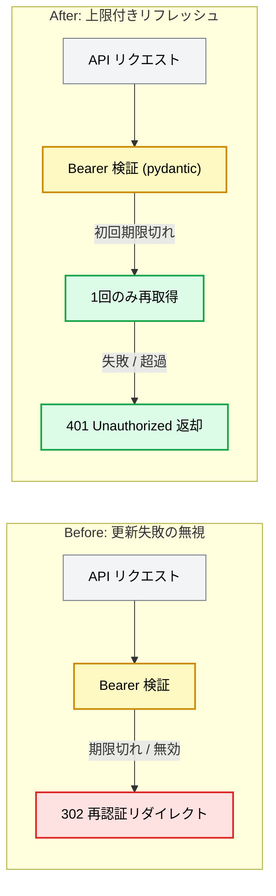
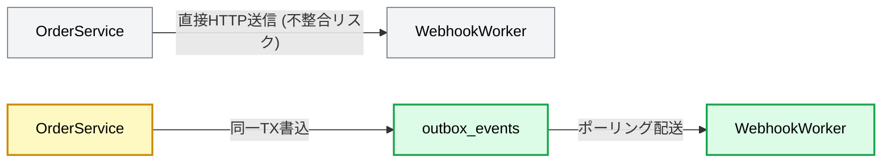
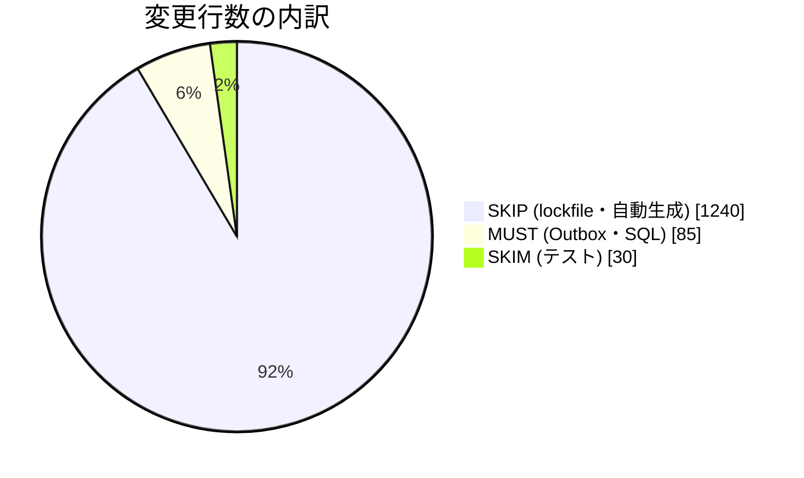

# Gate 3: Visual-First テンプレート & GFM Mermaid 安全規約正本

本ドキュメントは Gate 3 で出力する Size M / L / XL 向け PR 本文テンプレート、Text-Only モード差分、Mermaid 図種選定、および GitHub Flavored Markdown（GFM）でのレンダリング安全規約を定める。

> [!NOTE]
> **Size S の最小テンプレートは `SKILL.md` を正本とし、重複定義しない。** Size S 判定時は Mermaid 図・Markdown 表・Scope バナー・`<details>`・設計判断表を一切出力しない（規模閾値は [triage-rules.md](triage-rules.md)、日本語表記規則は [japanese-pr-style.md](japanese-pr-style.md) を参照）。

## 目次

- [1. Size M / L / XL 標準テンプレート骨格](#1-size-m--l--xl-標準テンプレート骨格)
- [2. Text-Only モード差分仕様](#2-text-only-モード差分仕様)
- [3. Mermaid 5 種ルーティング表と図数上限](#3-mermaid-5-種ルーティング表と図数上限)
- [4. GitHub Flavored Markdown（GFM）Mermaid 完全安全規約](#4-github-flavored-markdown-gfm-mermaid-完全安全規約)
- [5. 検証済みサンプル PR テンプレート（コピー参照用）](#5-検証済みサンプル-pr-テンプレートコピー参照用)

---

## 1. Size M / L / XL 標準テンプレート骨格

### 1.1 基本構成（Size M / Size L）

1. **`## TL;DR`（必須）**: 最大 3 行・日本語 150 字目安で「なぜ（Why）変えたか」と「外から観測できる振る舞いの変化」を書く。直下に `> 🎯 Scope: ...` 引用バナーを置き、見かけ総差分と熟読対象（実質コード・ファイル数・推定レビュー時間）を対比させる。
2. **`## 1. アーキテクチャ比較（Before / After）`（必須）**: 構造・依存・データフローの変化を `flowchart LR` 等で示す。
3. **`## 2. 振る舞い・エッジケース図解`（条件付き任意）**: API フロー・非同期処理・状態遷移・DB スキーマ変更がある場合のみ `sequenceDiagram` / `stateDiagram-v2` / `erDiagram` を出力する。
4. **`## 3. 差分トリアージと読むべきコード`（必須）**:
   - 条件（ノイズ率 `>= 30%` または `safe_to_skip_lines > 0` かつ非ゼロ区分 2 つ以上）を満たす場合は定量 `pie showData` を添える。
   - `### 🎯 読むべきファイル` に番号付き表を置き、**理解しやすい順（型・スキーマ契約 → コアロジック → 呼び出し元・結線 → テスト）** に並べる（アルファベット順は禁止）。
   - `safe_to_skip_files > 0` の場合は `<details>` 折りたたみを含め、依存追加・更新があるときはパッケージ名と導入理由 1 行を必ず明記する（例: `- 依存追加: <pkg>（理由1行）`）。
5. **`## 4. 設計判断マトリクス`（条件付き任意）**: 複数の実装案やトレードオフを比較した場合のみ、`◎ / ○ / △ / ×` を使った比較表を置く。
6. **`## 5. 検証ステータス`（必須）**: 実際に実行し成功を確認したコマンドのみ `- [x]` とし、未実行テストや人間確認事項は `- [ ]` へ分離する。

> [!TIP]
> **省略時の連番詰めルール**: `## 2.` や `## 4.` など該当変更がない任意節を省く場合は、「該当なし」等の空見出しを残さず節ごと削除し、`## 1.`〜`## N.` の見出し番号を欠番にせず連番で詰める（`pr_body_lint.py` も見出し番号ではなく構造で見る）。

### 1.2 Size XL 判定時の Split Proposal + 1 本版同時出力骨格

Size XL を検知した場合は、**最初に PR 分割提案（Split Proposal）を提示し、続けて `> [!WARNING]` 付きの 1 本版 PR 本文ドラフトも同時出力する**。

```markdown
## PR 分割提案（Split Proposal）

変更規模が大きいため（例: 22ファイル / 実質 740行）、以下の順で積み上げ分割することを推奨する。

1. PR 1（スキーマ・型契約）: `db/migrations/**`, `src/types/**`
2. PR 2（コアロジック）: `src/domain/**`, `tests/domain/**`
3. PR 3（API 結線・UI）: `src/api/**`, `tests/api/**`

---

> [!WARNING]
> **推奨規模を超過（Size XL）**: 分割せず 1 本でレビューする場合は、下記の `🧠 Must-Read` 上位ファイルから順に確認すること。

## TL;DR
...（以降は Size L 標準骨格。Mermaid は責務単位に集約し 10 ノード以下厳守）
```

---

## 2. Text-Only モード差分仕様

`--badge-mode text`（ユーザー指定、または `CLAUDE.md` / `AGENTS.md` / PR テンプレートに絵文字禁止指示がある場合）は、4 種の絵文字バッジを含め**絵文字を 1 文字も出力しない**。同一 PR 内での絵文字バッジとテキストバッジの混在も禁止する（`PR014`）。

| 出力位置 | Visual Badge Mode（既定: `auto` / `emoji`） | Text-Only Mode（`--badge-mode text`） |
|---|---|---|
| Scope バナー行頭 | `> 🎯 Scope: ...` | `> [SCOPE] ...` |
| 読むべきファイル見出し | `### 🎯 読むべきファイル` | `### [TARGET] 読むべきファイル`（または `### 読むべきファイル`） |
| 熟読対象区分 | `🧠 Must-Read` | `[MUST]` |
| 流し読み対象区分 | `👀 Skim` | `[SKIM]` |
| 読み飛ばし可区分 | `⏭️ Safe-to-Skip` | `[SKIP]` |
| `<summary>` 行頭 | `<summary>⏭️ Safe-to-Skip（Nファイル / M行）</summary>` | `<summary>[SKIP] Safe-to-Skip（Nファイル / M行）</summary>` |
| `pie showData` ラベル | `"Must-Read (認証・コア)" : 140`（図内も絵文字なし） | `"MUST (認証・コア)" : 140` |

- Text-Only Mode で初めて読む人向けに凡例を添える場合は、表直前に `区分: [MUST] 熟読 / [SKIM] 流し読み / [SKIP] 自動生成・ロックファイル` と 1 行で書く。Markdown の参照リンク定義 `[MUST]: url` と誤認される書式は避ける。

---

## 3. Mermaid 5 種ルーティング表と図数上限

- **図数上限**: 主図解（`flowchart LR` / `sequenceDiagram` / `stateDiagram-v2` / `erDiagram`）は **1〜2 個**。条件を満たす場合のみ定量内訳 `pie showData` を **1 個** 追加でき、**総計上限は 3 ブロック** とする。

| Mermaid 図種 | 使う場面 | 含める要素・制約 |
|---|---|---|
| `flowchart LR` | アーキテクチャ比較（Before / After）、データフロー・依存境界の変化 | `Before` / `After` サブグラフ、合計 8〜10 ノード以内、規定 `classDef` 4 色（`color:#000`） |
| `sequenceDiagram` | API 呼び出し・非同期ジョブ・エラー分岐・リトライ順序 | `autonumber`＋`alt`/`else`、アクター上限 10 以下、`classDef` 禁止 |
| `stateDiagram-v2` | 状態遷移マシン、注文/ジョブ/セッションのライフサイクル変化 | 状態 ID にハイフン `-` 禁止、`classDef` 禁止 |
| `erDiagram` | DB スキーマ・テーブルリレーション追加・外部キー変更 | 変更テーブル＋直接関連 1 ホップのみ、型内 `()` とエンティティ名ハイフン禁止、`classDef` 禁止 |
| `pie showData` | Gate 2 トリアージの定量内訳（ノイズ率 `>= 30%` または `safe_to_skip_lines > 0` かつ非ゼロ 2 区分以上のみ） | **Gate 1 削減量の円グラフ作成は厳禁**。0 値・単位文字・ラベル内 `:` 禁止 |

---

## 4. GitHub Flavored Markdown（GFM）Mermaid 完全安全規約

GitHub の Mermaid レンダラで構文エラーとダークモード視認性低下を防ぐため、以下をすべて必須とする。

1. **ノード数上限（8〜10 ノード）**: 1 図あたり `Before` と `After` を合算して **最大 8〜10 ノード** に収める（`PR007` は 9〜10 で `WARN`、11 以上で `FAIL`）。ファイル単位ではなくモジュールや責務単位へ集約する。
2. **予約語裸 ID 禁止**: `end`, `class`, `subgraph`, `graph`, `flowchart`, `style`, `click`, `default` を裸のノード ID に使わない（例: `end` は `n_end` にする）。特に小文字 `end` は `subgraph` 終端と衝突する。
3. **`:::` 短縮記法禁止**: `A:::added` のような連結指定は使わず、`class A,B added` の別行指定に統一する。
4. **特殊文字ラベルの `"..."` クォート必須**: `/`, `()`, `[]`, `{}`, `:`, `;`, `#`, `&`, `@`, 空白, 日本語を含むノードラベル・矢印ラベル（`A -->|"認証失敗 (401)"| B`）・`subgraph` タイトル（`subgraph before["Before: 従来"]`）・`participant` エイリアス（`participant api as "API (v2)"`）は必ず `"..."` で囲み、内側に二重引用符 `"` を含めない（`PR008`）。
5. **生 `<>` 禁止**: HTML サニタイズ崩れを防ぐため、ラベル内の `<` と `>` は使用禁止とする（改行に限り `<br/>` のみ許可）。
6. **`classDef` は `flowchart` 限定＆規定 4 行固定**:
   - `sequenceDiagram` / `stateDiagram-v2` / `erDiagram` / `pie` での `classDef` 使用は GFM で構文エラーになるため厳禁（`PR009`）。
   - ダークモードでの白文字同化を防ぐため、以下の 4 行をそのまま使用する（すべて `color:#000` 必須）。

```mermaid
classDef added fill:#dcfce7,stroke:#16a34a,stroke-width:2px,color:#000
classDef modified fill:#fef9c3,stroke:#ca8a04,stroke-width:2px,color:#000
classDef risk fill:#fee2e2,stroke:#dc2626,stroke-width:2px,color:#000
classDef base fill:#f3f4f6,stroke:#6b7280,stroke-width:1px,color:#000
```

7. **図種別の固有禁止事項（`PR017`）**:
   - `pie showData`: `0` 値スライス禁止、数値への単位文字（`120行`）禁止、`title` やラベル内の `:` 禁止（区切り文字誤認防止）。非ゼロ区分が 1 種だけのときは図ごと省略する。
   - `erDiagram`: エンティティ名にハイフン `-` を使わない。属性型内の `()`（`varchar(255)` → `varchar`）や `< >`（`List<String>` → `string_array`）を書かない。
   - `stateDiagram-v2`: 状態 ID にハイフン `-` を使わない（表示名が必要なら `state "rate-limited" as rate_limited` を使う）。
   - `subgraph`: `direction` 指定とサブグラフ内外ノード間のクロス接続を併用しない。

---

## 5. 検証済みサンプル PR テンプレート（コピー参照用）

以下の 3 例は `pr_body_lint.py` 規約および `/yomiyasu` 準拠の日本語基準（`yomiyasu_lint.py --doc-type pr --reader expert` 基準）を満たす見本である。

### 例 1: Size S（単一レイヤーバグ修正・図表・表・`<details>` なし）

````markdown
## TL;DR

日付フォーマット変換時に `expiresAt` が `null` の入力で `TypeError` が発生する不具合を修正した。期限未設定の入力を受け取った場合は空文字へ変換せず `null` をそのまま返す。

## 検証ステータス

- [x] `python3 -m unittest tests/test_date_format.py` を実行して修正後の挙動を検証し、全6件の通過を確認
````

### 例 2: Size M / L（Visual Badge Mode・図解 3 ブロック以内・理解順表・比較表・`[x]`/`[ ]` 分離）

````markdown
## TL;DR

期限切れ JWT を受け取った認証ミドルウェアが再ログインへ無限リダイレクトしていた不具合を修正した。リフレッシュ試行を 1 回までに制限し、失敗時は `401 Unauthorized` を返してセッションを終了する。

> 🎯 Scope: 総変更 2,760行 (12ファイル) / 熟読対象 210行 (5ファイル: Must-Read 140行・Skim 70行) / 推定レビュー時間 8〜12分

## 1. アーキテクチャ比較（Before / After）



## 2. 振る舞い・エッジケース図解


## 3. 差分トリアージと読むべきコード


### 🎯 読むべきファイル

| 優先順 | ファイル | 区分 | 変更理由 |
|---|---|---|---|
| 1 | `src/types/auth_schema.py` | 🧠 Must-Read | `RefreshRequest` の境界検証スキーマ定義 |
| 2 | `src/domain/token_verifier.py` | 🧠 Must-Read | 期限切れ判定と 1 回上限リフレッシュ制御 |
| 3 | `src/api/auth_middleware.py` | 🧠 Must-Read | 失敗時の 401 返却分岐とログ記録 |
| 4 | `src/api/routes.py` | 👀 Skim | 新ミドルウェアの DI 結線 |
| 5 | `tests/test_auth_refresh.py` | 👀 Skim | 期限切れ・上限超過・境界値テスト 14 件 |

<details>
<summary>⏭️ Safe-to-Skip（7ファイル / 2,550行）</summary>

- 依存追加: pydantic（リクエスト境界のスキーマ検証とフィールド単位エラー返却のため導入）
- `pyproject.toml`: `pydantic` 依存定義の追加
- `uv.lock`: `pydantic` 導入に伴う自動解決ロックファイル更新（2,100行）
- `src/api/client.gen.py`: OpenAPI スキーマ更新に伴うクライアントコード再生成（420行）
- `tests/__snapshots__/auth.snap`: 401 レスポンス形式変更に伴うスナップショット更新（30行）

</details>

## 4. 設計判断マトリクス

| 候補方式 | 認証ループ抑止 | 既存クライアント互換 | 実装工数 | 採用 |
|---|---|---|---|---|
| サーバー側 1 回リフレッシュ＋失敗時 401 返却 | ◎ 再試行上限をサーバーで強制 | ○ 既存ヘッダ仕様を維持 | ○ ミドルウェア局所変更 | 採用 |
| クライアント側バックオフ再試行のみ | △ 端末実装差でループ残存 | ◎ サーバー無変更 | × 全クライアント改修要 | 不採用 |

## 5. 検証ステータス

- [x] `pytest tests/test_auth_refresh.py` を実行し、全14件の通過を確認
- [x] `mypy src/` と `ruff check src/` を実行し、型エラー・指摘 0 件を確認
- [ ] ステージング環境での期限切れトークン再ログイン遷移確認（手動確認待ち）
````

### 例 3: Text-Only モード（`--badge-mode text`・絵文字 0 件）

````markdown
## TL;DR

注文イベントを非同期 Outbox テーブルへ永続化してからワーカーへ配送する経路を追加した。DB コミット失敗時に通知だけが先行送信される不整合を防ぐ。

> [SCOPE] 総変更 1,355行 (6ファイル) / 熟読対象 115行 (3ファイル: MUST 85行・SKIM 30行) / 推定レビュー時間 5〜8分

## 1. アーキテクチャ比較（Before / After）



## 2. 差分トリアージと読むべきコード

区分: [MUST] 熟読 / [SKIM] 流し読み / [SKIP] 自動生成・ロックファイル



### [TARGET] 読むべきファイル

| 優先順 | ファイル | 区分 | 変更理由 |
|---|---|---|---|
| 1 | `db/migrations/002_outbox.sql` | [MUST] | `outbox_events` テーブルと状態インデックス定義 |
| 2 | `src/domain/order_service.py` | [MUST] | 注文保存と Outbox 挿入のトランザクション統合 |
| 3 | `tests/test_outbox.py` | [SKIM] | ロールバック時にイベント未登録を確かめるテスト 6 件 |

<details>
<summary>[SKIP] Safe-to-Skip（3ファイル / 1,240行）</summary>

- `pnpm-lock.yaml`: パッケージ解決の自動更新（1,050行）
- `src/db/types.gen.ts`: SQL スキーマから型定義を再生成（190行）

</details>

## 3. 検証ステータス

- [x] `pnpm test tests/test_outbox.py` を実行してトランザクション挙動を検証し、全6件の通過を確認
- [ ] 本番相当 DB でのマイグレーション適用時間計測（ステージング確認待ち）
````
