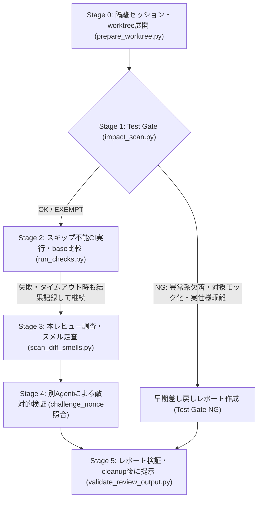

# yharuto-code-review

読み手である人間の認知負荷を抑えつつ、テスト・CI・コード構造・AI Slop に対しては仕組みで妥協しない、`fable-code-review` 後継の読み取り専用コードレビュースキルです。

対象リポジトリを一切汚さない `.gemini` 配下の完全隔離ワークツリー展開、異常系やモック乖離を審査する `Test Gate`、スキップ不能な CI 実行、実コード照合と AI Slop 監査、別コンテキストの検証 Agent による敵対的検証、出力検証と一時環境清掃までの **6段階パイプライン（Stage 0〜Stage 5）** を状態遷移と HMAC 封印で管理します。完璧を求めずコードベースの健全性（Code Health）向上を軸に判定を下し、評価語を含まない変更概要（または監査概要）・強調判定・実コード根拠付きの4区分（`Bug` / `Risk`、および結論に影響しない変更コード限定の `Nit` / `Question`）を表と `mermaid` 図で出力します。

## 機械的保証の範囲と前提

同梱スクリプトはステージ実行順序、各検査ツール（`impact_scan.py`・`run_checks.py`・`scan_diff_smells.py`）の実行証跡と出力ハッシュ照合、ワンタイム `challenge_nonce` と全候補照合・対象ファイル網羅を含む Stage 4 応答構造、HMAC-SHA256 による `gate_state.json` 改ざん検知、対象リポジトリの `git status` 清浄性、およびレポート構造・相対リンク・日本語品質（内蔵 `_prose_lint.py` と任意の `yomiyasu_lint.py` 連携）を機械的に強制します。一方、個別指摘の意味論的な妥当性や別 Agent のコンテキスト独立性は実行ハーネス（サブエージェント機構や外部 CLI）に依存します。

## インストール方法

`npx skills` または GitHub CLI（`gh skill`）で導入できます。

```bash
# npx skills を使用する場合
npx skills add yharuto0917/yharuto-agent-skills --skill yharuto-code-review

# GitHub CLI (gh skill) を使用する場合
gh skill install yharuto0917/yharuto-agent-skills yharuto-code-review
```

## ディレクトリ構成

```text
yharuto-code-review/
├── README.md                        # 本ドキュメント
├── SKILL.md                         # スキル本体（8原則・JIT読込表・6段階パイプライン手順）
├── references/
│   ├── judgment.md                  # 実コード照合・4区分分類・Code Health 判定・棄却4パターン・6点不変条件
│   ├── output-format.md             # 出力構造（stage1_ng / full / audit）・強調判定・日本語校正規則
│   ├── structural-remedies.md       # 構造改善提案時の原則とアンチパターン防止基準
│   └── subagent-prompts.md          # Stage 4 敵対的検証プロンプトと大型差分の並列調査定義
├── guidelines/
│   ├── cross-cutting.md             # 横断的な不具合・境界漏れ・実ブラウザ描画乖離の監査基準
│   ├── code-slop.md                 # AI Slop 監査基準（二重実装・文字列化・重複監視・過剰防御など）
│   ├── concurrency-data.md          # 並行更新競合・トランザクション・データ整合性の監査基準
│   ├── dependencies.md              # 依存関係・ビルドハッシュ設定・破壊的変更の監査基準
│   ├── security.md                  # 認証・認可・信頼境界・未信頼コード防御の監査基準
│   └── stacks/                      # 言語・フレームワーク別の重点監査基準（TS/React, Python, Go/Rust）
├── scripts/
│   ├── _lib.py                      # セッション解決・HMAC状態封印・共通JSON/コマンド/表パーサ基盤
│   ├── _prose_lint.py               # 外部依存ゼロの内蔵日本語リンター＋任意外部 yomiyasu_lint.py 連携
│   ├── prepare_worktree.py          # 隔離展開・Stage 1/4 証跡検証・一時環境と鍵の削除
│   ├── impact_scan.py               # 関連テスト・モック・比較対象・ビルド設定の抽出と証跡記録
│   ├── run_checks.py                # lint / typecheck / test / build 実行・base比較・未信頼実行遮断
│   ├── scan_diff_smells.py          # 差分から危険シグナルと AI Slop 候補行を機械抽出・証跡記録
│   ├── validate_review_output.py    # 出力構造・証跡整合・Git清浄性・リンク形式・日本語品質の機械検証
│   └── post_pending_review.py       # GitHub PR への下書きレビュー（Pending Review）投稿
├── tests/                           # 全スクリプト・攻撃耐性・脱汚染を検証する unittest スイート
└── evals/
    ├── evals.json                   # 5ケースの客観評価定義と期待条件
    ├── trigger_evals.json           # スキル起動判定の評価セット
    ├── fixtures/                    # 各評価ケースの再現用ベース・PR差分データ
    ├── materialize_fixture.py       # フィクスチャから一時 Git リポジトリと PR メタ情報を生成
    └── grade_review_output.py       # レビュー出力とパイプライン証跡の自動採点スクリプト
```

## 必須6段階パイプライン（Stage 0〜Stage 5）

Stage 0 の完全隔離展開から Stage 5 の機械検証・清掃までの6段階を順番に実行します。途中の段階や必須スクリプトを飛ばして最終検証を通過することはできません。



| 段階 | 主な実施内容と品質保護の仕組み |
| :--- | :--- |
| Stage 0: 隔離展開 | 既定で `~/.gemini/tmp/yharuto-code-review/`（`--session-scope project` 時は `<repo>/.gemini/tmp/yharuto-code-review/`）配下にセッションと全モード共通の隔離 `worktree` を作成し、標準出力パス（`draft_findings_path`・`adversarial_input_path`・`adversarial_response_path`・`review_output_path`）と `merge_base_sha..head_sha` の差分・ベース側 `REVIEW.md` を返します。 |
| Stage 1: `Test Gate` 審査 | `impact_scan.py --session` の実行証跡を必須とし、変更ロジックの異常系・境界値テスト欠落、検査対象関数自体のモック化、模擬データやモックDOMと実仕様の乖離を審査します。不備があれば Stage 2 以降へ進まず即座に差し戻します。 |
| Stage 2: スキップ不能CI実行 | 隔離 `workdir` で `lint`・`typecheck`・`test`・`build` の自動実行と `gh pr checks` 照合を行います。ローカル検査失敗時は `merge_base_sha` とも比較して変更起因の回帰失敗（`failed`）と既存失敗（`failed_preexisting`）・`timed_out`・`pending` を区別します。フォークPR・`--untrusted` 指定時・危険なCIスクリプト改ざん（`ci_script_hazard`）検出時は動的実行を自動遮断します。 |
| Stage 3: 本レビューと AI Slop 監査 | `scan_diff_smells.py --session` の実行証跡を必須とし（スメル検出時は `findings` または `dismissed_smells` の根拠記載を要求）、実ブラウザ描画乖離・認可漏れ・並行競合と AI Slop 重点観点（二重実装・文字列化コード・重複監視・モック都合の過剰防御など）、および変更コード上の `Nit`・`Question` を選別します。 |
| Stage 4: 別Agent敵対的検証 | ドラフト0件時も含め、親履歴を持たない検証 Agent へ `adversarial_input.md` と `judgment.md` のみを渡します。ワンタイム `challenge_nonce` の一致、全 `draft_findings` ID への回答、`audit_notes`、`testable_code_files` の `checked_files` 網羅を `record-stage4` が機械検証します。 |
| Stage 5: 機械検証と環境清掃 | 中間JSONと検証対象の `<session_dir>/review.md` は `<session_dir>` 内にのみ書き込み、対象リポジトリには1ファイルも作成しません。`validate_review_output.py --session` 通過後、`cleanup` 前に `<session_dir>/review.md` の内容を控えてから `prepare_worktree.py cleanup --session` で一時環境と鍵を削除し、その後にチャットへ提示します。 |

## レビュー判定と4つの指摘区分

すべてのレポートは冒頭の `## 変更概要`（`audit` モードでは `## 監査概要`）の直後に、コードベースの健全性（Code Health）に基づく判定見出しと対応 GitHub Alert を明示します。

| レビュー判定見出し | 対応 Alert | 適用される条件 |
| :--- | :--- | :--- |
| `🛑 Test Gate NG（テスト修正差し戻し）` | `[!CAUTION]` | Stage 1 で異常系・境界値テストの欠落、検査対象関数のモック化、模擬データと実仕様の乖離が検出された場合 |
| `🔴 Request changes`（監査時: `🔴 要修正（重大な懸念あり）` も可） | `[!CAUTION]` | 確定した不具合（`🔴 Bug`）、変更に起因する CI 回帰失敗（`failed`）、または深刻な `🟡 Risk` によるコードベース健全性の明確な悪化がある場合 |
| `🟡 Comment`（監査時: `🟡 要確認（構造・保守上の懸念あり）` も可） | `[!WARNING]` | 不具合や変更起因の CI 失敗はないが、モック都合の過剰防御分岐や共有モジュールの責務混在などの `🟡 Risk` により現状では健全性が向上しているとは言えず、整理や方針確認を求める場合 |
| `🟢 Approve`（監査時: `🟢 健全（重大な懸念なし）` も可） | `[!TIP]` | 確定不具合と変更起因の CI 回帰失敗（`failed`）が0件で、変更全体としてコードベースの健全性が向上している場合（`🔵 Nit`・`❓ Question`、軽微な `🟡 Risk`、base既存の `failed_preexisting`・`timed_out`・`pending` は `🟢 Approve` を妨げません） |

`## 指摘事項` では、該当がある区分を次の優先順で並べます。`🔴 Bug` と `🟡 Risk`（および `🛑 Test Issue`）は標準4列表（`| 箇所 | 対象 | 型・契約 | 処理内容と目的 |`、後方互換で `引数と返り値` も許容）＋箇条書き2項目以上で記述し、非ブロッキングな `🔵 Nit` と `❓ Question` は4列表形式またはリポジトリ相対リンク付きの簡潔箇条書き形式（1〜3項目）で記述できます。PR概要更新漏れ等のコード外メタ事項は一切出力しません。

| 指摘見出し区分 | 対象範囲 | レビュー結論への影響と内容 |
| :--- | :--- | :--- |
| `### 🔴 Bug:` | 今回の変更による実害経路 | 1件以上で必ず `🔴 Request changes` とする確定不具合（機能不全・認可突破・データ不整合など） |
| `### 🟡 Risk:` | 今回の変更による構造・境界懸念 | 全体の健全性収支に応じて判定へ反映する懸念（境界検証漏れ・競合・空 `catch` による例外破棄・AI Slop など） |
| `### 🔵 Nit:` | 今回の変更コード行のみ | 結論に一切影響しない非ブロッキングな軽微改善提案（マジックナンバーの定数化・命名明確化など） |
| `### ❓ Question:` | 今回の変更コード行のみ | 結論に一切影響しない非ブロッキングな意図・仕様・境界前提の確認質問（丸め規則変更の意図確認など） |

## 使い方

コーディングエージェント上で自然言語または `/yharuto-code-review` から呼び出せます。外部コントリビュータや未信頼ブランチを `--range`・`--local`・`--audit` で検査する際は `--untrusted`（別名 `--fork`）を付与してください。

| 対象 | エージェントへの依頼例 | パイプライン内部で用いる主なコマンド |
| :--- | :--- | :--- |
| GitHub PR | `/yharuto-code-review PR #42 をレビューして` | `python3 scripts/prepare_worktree.py prepare --repo . --pr 42` |
| コミット範囲 | `main..feature/auth の変更差分をレビューして` | `python3 scripts/prepare_worktree.py prepare --repo . --range main..feature/auth [--untrusted]` |
| ローカル差分 | `コミット前のローカル変更に問題がないかチェックして` | `python3 scripts/prepare_worktree.py prepare --repo . --local [--session-scope global]` |
| 全体・指定パス監査 | `src/auth/ 配下の設計とセキュリティを監査して` | `python3 scripts/prepare_worktree.py prepare --repo . --audit src/auth/` |
| Pending Review 下書き投稿 | `PR #42 をレビューして GitHub に下書きレビューを作成して` | 検証通過後に `python3 scripts/post_pending_review.py --session <dir> --repo <owner/repo> --pr 42 --review-md <review_output_path>` |

`post_pending_review.py` は GitHub 上に未送信の Pending Review を作成するのみで、自動的な Approve や Submit は行いません。投稿前に内容を確認したい場合は `--dry-run` を付与します。

## 単体テストと評価スイートの実行方法

1. スクリプト群・証跡ロック・未信頼コード遮断・脱汚染の単体テストを実行します。

```bash
python3 -B -m unittest discover -s skills/yharuto-code-review/tests -v
```

2. 評価フィクスチャを展開して客観採点スクリプトを実行します。

```bash
# 利用可能なフィクスチャ名の一覧を表示し、一時リポジトリへ展開
python3 skills/yharuto-code-review/evals/materialize_fixture.py --list
python3 skills/yharuto-code-review/evals/materialize_fixture.py --fixture stage1-test-gate-ng

# 監査ログ付きで実行した出力を採点
python3 skills/yharuto-code-review/evals/grade_review_output.py \
  --eval-id 1 \
  --review-md <output_review.md> \
  --audit-log <gate_audit.json> \
  --repo-dir <materialized_repo_dir> \
  --output <grading.json>
```
